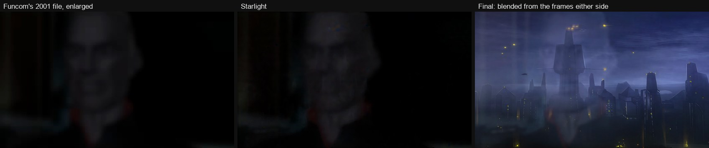
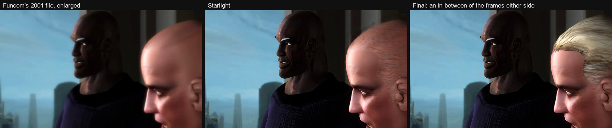
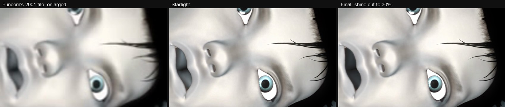
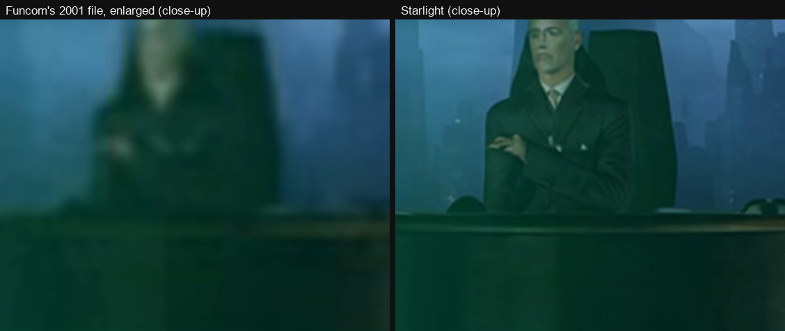
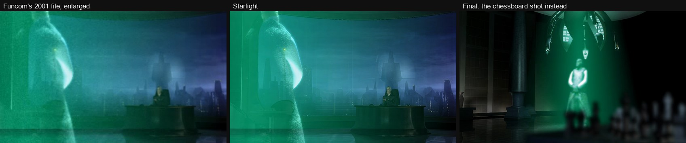
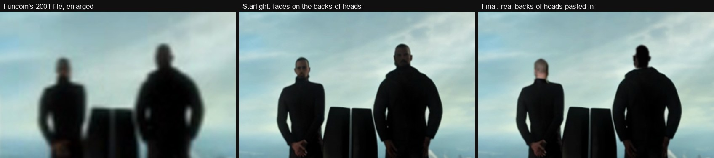
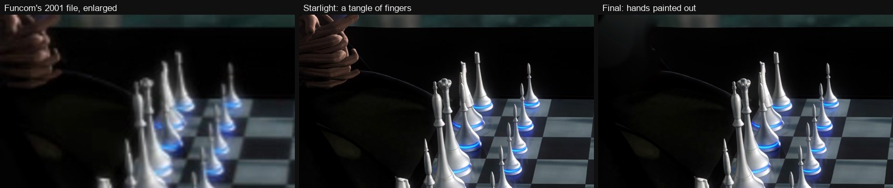
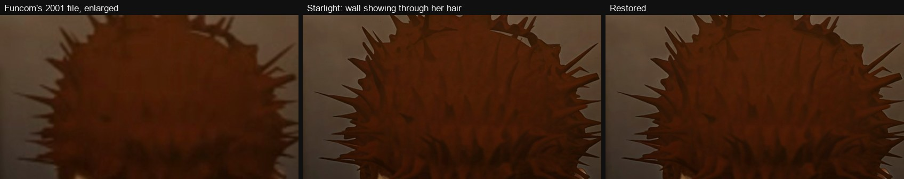

# Decisions

Every change made to Starlight's picture, and why. Times are in the [YouTube video](https://www.youtube.com/watch?v=fbWhNT7Bz5k) of the whole series.

There are 114 fixes, in three kinds:

- **Corrections (93).** Starlight drew something the original doesn't show, and the fix brings back what the
  original shows. Most of the work.
- **Compromises (12).** Starlight drew something wrong, and what the original shows couldn't be recovered at the
  new size, so the fix changes how the shot plays. A frame is held still, a shot is swapped for another, or something
  is painted out.
- **Changes to the original (9).** The flaw is in Funcom's original itself, and it was changed anyway. These are
  aesthetic calls, and the ones most open to argument.

| Episode | Corrections | Compromises | Changes to the original | All |
|---|---|---|---|---|
| 101 | 24 | 3 | 4 | 31 |
| 102 | 46 | 1 | 0 | 47 |
| 103 | 4 | 6 | 1 | 11 |
| 104 | 19 | 2 | 4 | 25 |
| **All** | **93** | **12** | **9** | **114** |

A full list of all 114 is at the end. Each one was tried as a short clip, Starlight first and then the fix, and
kept, redone or dropped on the reviewer's call.

## Changes to the original

These go beyond undoing the AI. The original has the flaw too.

**A glitch frame (101, 3:37).** One frame in the middle of a dissolve is nearly black: the city layer is missing, a
glitch in Funcom's file. It is replaced by an even blend of the frames either side.

**A line down the hologram's edge (101, 4:46, 4:53, 5:37).** In three hologram close-ups the original has a faint
light line down the left edge, which Starlight turns into a bright column beside a dark one. The outer three columns
of pixels are mirrored from just inside.

**A bald frame (103, 33:52).** For one frame Ross's hair vanishes and a bare scalp shows, in the original too. That
frame is replaced by a motion-compensated in-between of the frames either side.

**A shiny mouth (104, 37:25 and 37:43).** Eleena lies on the table with her mouth open. The original's mouth is shiny
inside; Starlight makes it glossy grey lobes, shinier than black. The shine is cut to 30% inside a mask of the
opening, keeping its colour.

**Broken teeth (104, 38:51).** In the close-up of Eleena at the bar, her teeth are badly broken up, in the original
as well, and no fix looked right. Three were tried: real teeth taken from a later shot, the gaps closed, the row
pulled into shadow. The decision was to cut away instead. The close-up runs until just before the gap in her teeth
shows; the rest of the shot is the bar's wide shot from a few seconds earlier, at its own speed. The same teeth later
in the episode (around 42:00) are left as they are.

**A bigger word (104, 45:42).** In one BABOONS shot the corrected word was made 12% bigger than the print it
replaces, on the reviewer's call: at the print's own size it read as too small.

**Presentation.** The opening titles appear once, at the start; 102–104 each had the same sequence after the teaser.
The end credits appear once, at the end: the identical credits after 101–103 are cut at the fade to black before
them. The one name only 101's credits have (casting: Elin Mosnesset) is in the video's description.

## Compromises

Where Starlight got something wrong and the original, at 352×188, doesn't hold enough to redraw it right.

**Ross at his desk (101, 8:44).** In a medium shot behind the hologram, Starlight turns Ross into a sharp, specific
man in a suit and tie who isn't him. The shot is replaced by the chessboard shot from 4:47 (fixed the same way),
its first frame held for the 18 frames it was short.

**Ross talking to Eva (101, 9:14).** Far away at his desk, Starlight makes him someone else and no fix holds. The
shot opens a little later, where the focus pull has already softened his face, easing out from a slight zoom.

**The robot (101, 13:48).** Starlight paints a human face on a robot's smooth dome. Proteus gives the dome back; that
clean frame is then held still until the close-up.

**Radiman at his desk (102, 16:45).** In a wide shot Starlight makes Radiman a young male model. The shot is
replaced by a still of the viewscreen he is speaking to, cropped from a later shot. The sound is unchanged.

**Ross small at his desk (103, 32:43).** Starlight gives him black hair, a face that changes, glowing eyes and
glowing hands. His head and hands are held as they are in one good frame, with the hair recoloured to his real grey.

**Ross standing at his desk (103, 33:06).** Starlight turns his hand into a flame, and then him into a city tower. He
is held as he is at the start of the shot; the bald man walking past stays in front of him.

**The pull-back (103, 33:53).** Starlight puts faces on the backs of both men's heads. The real backs of their heads,
from other shots where Starlight drew them right, are laid on instead, each at one size along a steady path.

**Radiman's hands at the chessboard (103, 34:39, 35:05, 35:32; 104, 40:52).** Starlight turns his clasped hands at
the corner of the board into a tangle of fingers. They are painted out from the dark around them. The original does
show hands there, soft ones; the corner is now empty shadow.

**Radiman at his window (104, 41:25).** Starlight draws a face with glasses and a beard on the back of his head. The
shot's first frame is held for the whole shot, his head softened. (The profile on his desk in this shot is of Snarf,
a real player: Funcom's in-joke, not ours.)

## Corrections

Where Starlight drew something the original doesn't show, and the fix puts back what it does.

| Kind | Fixes | What Starlight did |
|---|---|---|
| Lettering and logos | 39 | Misspelled the BABOONS print on Eleena's shirt ("BABNMES", "SABMIES", "MBMSS"…) and garbled the Bronto Burger logo. The right word is laid back in, tracked onto the shirt as it moves and bends |
| Faces and figures | 29 | Changed faces (the far hologram, Ross, Eva, Joshua), drew faces on the backs of heads, made tiny far figures into shiny dolls, added stubble and an ear |
| Hair | 14 | Let the wall or sky show through Eleena's spiky hair; those pockets are filled with hair colour |
| Signs | 7 | Spelled nonsense on signs that are unreadable in the original; they are softened back to unreadable |
| Scenery and objects | 4 | Turned a distant truck into a rock, a round object into a stand with letters, a faint streak into a sharp line |

## Left as Starlight on purpose

Things that were noticed and deliberately not changed:

- 101: several shirt logos that Starlight got close enough (L03, L05, L06, L09, L11–L14); Ross's reflection; a black
  frame that is in Funcom's original.
- 102: Eleena's glasses in the far shots behind the cookie stand (Starlight adds them; fixing them looked worse);
  the long profile shot with the misspelled print; two far shots behind the crates.
- 103: the sleeve of the man lying on the ground, which crawls, in the original too (a held frame was tried and
  turned down).
- 104: the broken teeth in the later shot at the bar.

## All fixes

The fix tables themselves are in [fixes/](fixes/); the commands that made each fix source are in
[tools/README.md](tools/README.md).

| Time | Ep. | Fix | Kind | What |
|---|---|---|---|---|
| 0:33 | 101 | U9 | correction | Nebula: a faint streak in the artwork that Starlight drew as a sharp line, painted out along its path |
| 1:07 | 101 | U1 | correction | Distant hover truck read as a rock (path from the tracked glow in testing) |
| 3:37 | 101 | U12 | change to the original | One near-black frame mid-dissolve (Ross reflection / city at dusk): a glitch in Funcom's original, where the city layer is missing; replaced by an even blend of frames 229 and 231 |
| 3:46 | 101 | U17 | correction | Ross far away at the window (3:47): Starlight drew a face on the back of his head; inside his silhouette, Starlight blurred 2 px, colour pulled 60% toward grey and darkened to 70% |
| 3:46 | 101 | U2 | correction | Wide office shot: the round object left of centre became a stand with letters |
| 3:58 | 101 | L01 | correction | Shirt logo after the hitch at frame 854 (before it Starlight is fine): correct logo composited from L12 (logo_composite.js), red text soft; lined up on Starlight's logo (--align=centroid) |
| 4:06 | 101 | L02m | correction | Shirt logo as she turns to face the camera and away again, carried along a tracked mesh (SAM 2 + CoTracker3) through the whole turn |
| 4:18 | 101 | L04 | correction | Shirt logo, pumpkin crowd behind her, into the fade to black; lined up on Starlight's logo (--align) |
| 4:31 | 101 | U4a | correction | Far hologram looks like a different person |
| 4:46 | 101 | U14a | change to the original | Hologram close-up: a light line down the left edge (in the original; Starlight makes it a bright and a dark column), outer 3 columns mirrored from inside |
| 4:47 | 101 | U4b | correction | Far hologram (after the focus pull from the chess pieces) |
| 4:53 | 101 | U14b | change to the original | Hologram close-up: light line down the left edge, as U14a |
| 5:32 | 101 | U4c | correction | Far hologram |
| 5:37 | 101 | U14c | change to the original | Hologram close-up: light line down the left edge, as U14a |
| 5:48 | 101 | U4d | correction | Far hologram |
| 6:26 | 101 | L07 | correction | Shirt logo, fight on the truck roof, low angle; lined up on Starlight's logo (--align) |
| 6:32 | 101 | L08 | correction | Shirt logo, fight; her fist passes in front (composite only where the original shows the logo); lined up on Starlight's logo (--align) |
| 6:43 | 101 | U10 | correction | Back of her head as the pumpkin man appears: pockets of sky showing through her hair filled with hair colour |
| 6:49 | 101 | L10m | correction | Shirt logo, small, standing on the truck roof: carried on a coarse tracked mesh (CoTracker3) following Starlight's slow drift, Starlight's leftover logo painted out |
| 7:31 | 101 | U4e | correction | Far hologram |
| 8:12 | 101 | U4f | correction | Far hologram |
| 8:44 | 101 | U16 | compromise | Ross at his desk, medium distance behind the hologram (8:44-8:51): Starlight hallucinated him badly; replaced by the chessboard shot from 4:47 (02 aoe101b 2342-2520 as fixed, with U4b), its first frame held 18 frames to fill the length; the dialogue carries on over it |
| 8:50 | 101 | U4g | correction | Far hologram |
| 9:14 | 101 | U18 | compromise | Ross far away at his desk talking to Eva (9:15-9:21): Starlight makes him someone else and no fix holds; the shot opens on frame 4143 (as fixed, where the focus pull has already softened his face), easing out from 1.10x about Ross to the normal framing, then plays on from 4143 |
| 9:21 | 101 | U5 | correction | Ross small at his desk: Starlight makes a different face, Proteus draws a lit building; Starlight blurred (sigma 1.5) with the original's grain |
| 9:23 | 101 | U11 | correction | Eva Pourais at the back of the office: Starlight drew her sharp with grey hair and an older face, contradicting her close-ups in 104 (black bob); kept soft like the original with Starlight blurred 1.5 + grain (as for Ross) |
| 10:25 | 101 | U6 | correction | Shirt: red text under the logo wonky (Proteus too); use the plain enlargement for the text only |
| 13:22 | 101 | U7 | correction | Man at the window facing out: a face drawn on the back of his head (office shot dissolves in) |
| 13:48 | 101 | U13 | correction | Robot in the background as the focus pulls to it: Starlight paints a human face on its smooth dome (the close-up right after shows two blue light slits); Proteus keeps it a soft lit dome like the original |
| 13:48 | 101 | U13b | compromise | Robot: the fixed head at frame 2218 held still until the close-up |
| 15:39 | 101 | U8 | correction | Masked man: Proteus, with the original's grain put back |
| 16:45 | 102 | V4s | compromise | Radiman at his desk (the wide shot where Starlight makes him a young model): replaced by a still insert of the viewscreen, cropped and enlarged 2.5x from the later back view (frames 1495-1562); the sound is unchanged |
| 17:49 | 102 | B01 | correction | BABOONS shirt: standing by the window: "DNNETONIET" |
| 18:08 | 102 | B18 | correction | BABOONS shirt: 0:34-0:37, overhead, seated (like B16) |
| 18:14 | 102 | B02 | correction | BABOONS shirt: seated across the desk: "EAKKOBBEB" |
| 18:26 | 102 | B03 | correction | BABOONS shirt: seated across the desk: "GANJNER" |
| 19:00 | 102 | B19 | correction | BABOONS shirt: 1:26-1:36, seated on the right side: "BABMES" |
| 19:16 | 102 | B20 | correction | BABOONS shirt: 1:42-1:44, seated on the right side: "BABMES" |
| 19:21 | 102 | B21 | correction | BABOONS shirt: 1:47-1:52, seated on the right side: "BABMES" |
| 19:30 | 102 | B16 | correction | BABOONS shirt: 1:56-2:01, overhead shot, seated, text seen steeply from above: unreadable smear |
| 19:40 | 102 | B17 | correction | BABOONS shirt: 2:06-2:09, on the right side of the frame at a slight angle: "BABANEB" |
| 19:48 | 102 | B04 | correction | BABOONS shirt: seated across the desk (her arm covers the text part of the time) |
| 20:00 | 102 | B25 | correction | BABOONS shirt: 2:27-2:29, above the cookie crates as the camera tilts up |
| 20:06 | 102 | B05 | correction | BABOONS shirt, alley by the cookie stand: Starlight writes "BABNMES"; the clean word from 09 frame 6701 composited (logo_composite.js --color=orange) |
| 20:23 | 102 | B06 | correction | BABOONS shirt: "BABMMES" |
| 20:32 | 102 | B07 | correction | BABOONS shirt: "BABNNS" |
| 20:39 | 102 | B22 | correction | BABOONS shirt: 3:06-3:14, far, behind the cookie stand (the glasses shot V1a) |
| 20:48 | 102 | B08 | correction | BABOONS shirt: "BABMNS" |
| 20:51 | 102 | B23t | correction | BABOONS shirt, 4:37-4:50 in the master (far, behind the cookie stand): placed from the print tracked with SAM 2 + CoTracker3, so it no longer grows, shrinks or rocks against her chest; letters only; the paint-out eased off by her arm |
| 21:04 | 102 | B09m-out | correction | BABOONS shirt, the alley turn (clips 17+18), turning away: the word bent along a tracked mesh (SAM 2 + CoTracker3) with no fade or blur, melting into Starlight's glow at her chest edge 6366-6374 |
| 21:07 | 102 | B09m-back | correction | BABOONS shirt, the alley turn, turning back: the same from the 6482 end, taking over 6400-6411 while only the glow shows; the word comes back round her chest edge 6446-6452; the word comes back gently (29 Oct, evening): word in over 6436-6456, Starlight's print painted out over 6450-6474, so the orange never dips |
| 21:11 | 102 | B24 | correction | Her left lens: the lower rim across her cheek softened from 6515; the shirt is left as Starlight here, too far away to matter |
| 21:22 | 102 | V2 | correction | She stands with her back to us: Starlight grows a face on the back of her head (fade-in to the dissolve) |
| 22:03 | 102 | B14 | correction | BABOONS shirt ("BASANES"): Starlight blurred 5 px (with grain) over the print as she comes up facing us, too dim for a composite |
| 22:20 | 102 | B15 | correction | BABOONS shirt: 0:59-1:00, small in the truck cab aiming a gun, then a yellow flash: Starlight writes gibberish. Missed by the scan |
| 24:50 | 102 | HF1 | correction | Desk scene close-up: pockets of wall showing through her hair filled with hair colour |
| 24:54 | 102 | B10 | correction | BABOONS shirt: seated at the desk: "SABMIES" |
| 25:02 | 102 | HF2 | correction | Desk scene close-up: pockets of wall showing through her hair filled with hair colour |
| 25:12 | 102 | HF3 | correction | Desk scene close-up: pockets of wall showing through her hair filled with hair colour |
| 25:26 | 102 | HF4 | correction | Desk scene close-up: pockets of wall showing through her hair filled with hair colour |
| 25:31 | 102 | B11 | correction | BABOONS shirt: seated at the desk: "SABMIES" |
| 25:43 | 102 | HF5 | correction | Desk scene close-up: pockets of wall showing through her hair filled with hair colour |
| 25:44 | 102 | B12 | correction | BABOONS shirt: seated at the desk: "SABMIES" |
| 25:51 | 102 | HF6 | correction | Desk scene close-up: pockets of wall showing through her hair filled with hair colour |
| 25:54 | 102 | B13 | correction | BABOONS shirt: seated at the desk: "SABMIES" |
| 26:04 | 102 | HF7 | correction | Desk scene close-up: pockets of wall showing through her hair filled with hair colour |
| 26:12 | 102 | V3 | correction | Joshua Khan walking towards us down the dark corridor: Starlight makes his face smooth and feminine |
| 27:18 | 102 | F1a | correction | Far warehouse shot: far warehouse shot 1, left figure, blurred 2 px with grain |
| 27:18 | 102 | F1b | correction | Far warehouse shot: far warehouse shot 1, right figure, blurred 2 px with grain |
| 27:35 | 102 | F2a | correction | Far warehouse shot: shot 2, left figure, blurred 2 px with grain |
| 27:35 | 102 | F2b | correction | Far warehouse shot: shot 2, right figure, blurred 2 px with grain |
| 28:05 | 102 | B27m | correction | BABOONS shirt, 11:50.6-11:52.5 (her profile in the ship, the quick shot after the cut to the ship's exterior): the 11:35 print carried along a tracked mesh like B26 |
| 28:13 | 102 | B26m | correction | BABOONS shirt, 11:58-12:00 (her profile, clip 25): the 11:35 print carried along a tracked mesh (SAM 2 + CoTracker3) instead of the blur; the corner the reference never had is Starlight softened 1.5 px |
| 28:56 | 102 | F3a | correction | Far warehouse shot: shot 3, left figure, blurred 2 px with grain |
| 28:56 | 102 | F3b | correction | Far warehouse shot: shot 3, right figure, blurred 2 px with grain |
| 29:03 | 102 | F4a | correction | Far warehouse shot: shot 4, left figure, blurred 2 px with grain |
| 29:03 | 102 | F4b | correction | Far warehouse shot: shot 4, right figure, blurred 2 px with grain |
| 29:21 | 102 | F5 | correction | Far warehouse shot: shot 5, the one figure, blurred 2 px with grain |
| 32:30 | 103 | R6a | correction | The blue sign on the tower (0:12.7-0:17.2): blurred 2 px inside its SAM 2 mask |
| 32:43 | 103 | R1 | compromise | Ross small at his desk (0:25.9-0:31.1 in the part): Starlight gives him black hair, a face that changes (glowing eyes at 830) and glowing hands; his head and hands are held as they are at 780 with the hair recoloured grey, fading out with the dissolve to the corridor (901-931) |
| 33:06 | 103 | R2 | compromise | Ross standing at his desk, back to us (0:48.5-1:05.3 in the part): Starlight makes his hand a flame from about 1540 and him a city tower from about 1585; he is held as he is at 1470 for the whole shot, the bald man walking past still in front |
| 33:33 | 103 | R3 | correction | Ross at the window, back to us (1:15-1:26 in the part): the face Starlight puts on the back of his head blurred, greyed and darkened to 70%, as 101 U17 |
| 33:52 | 103 | R4 | change to the original | Ross close up (1:34.5 in the part): for one frame his hair vanishes and a bare scalp shows, in the original too; his head there is a motion-compensated in-between of 2832 and 2834 (ffmpeg minterpolate), sharper than their average (101 U12 used the average) |
| 33:53 | 103 | R5r | compromise | The pull-back, Radiman and Ross backs to us (1:35.2-1:40.3): Starlight's phantom faces painted out and the real backs of their heads laid on, from Radiman at the window (1930, brightened 1.6x) and Ross at his desk (1470, 1.46/1.6/1.63), each at one size along a straight path through the shot, the painted-out area steadied over nearby frames |
| 34:20 | 103 | R6b | correction | The same sign (2:02.8-2:06.8), where Starlight tries to spell something: blurred the same |
| 34:24 | 103 | R7 | correction | Radiman at the chess table (2:06-2:11.5): Starlight gives him a stubbly beard; his jaw, cheek and chin blurred 2 px inside a soft shape over the beard area, only among his own pixels (SAM 2 head mask) and following his drift, lips and profile kept sharp; an oval round his jaw, not the whole frame, so the sign blur (R6b) stays in the dissolve, 3780-3800 |
| 34:39 | 103 | R8a | compromise | The overhead chessboard shot (2:21.5-2:28.2): Radiman's hands, which Starlight makes a tangle of fingers, painted out of the corner from the dark around them |
| 35:05 | 103 | R8b | compromise | The same (2:47.0-2:50.3) |
| 35:32 | 103 | R8c | compromise | The same (3:14.1-3:18.9) |
| 37:25 | 104 | M1a | change to the original | Eleena on the table, mouth open (0:09.5-0:22.1 in the part): Starlight draws the inside of her mouth as glossy grey lobes, shinier than black (the original's is shiny too); the shine is cut to 30%, colour kept, inside SAM 2's mask of the opening |
| 37:38 | 104 | E1 | correction | The woman in red in profile (0:22.1-0:27.2 in the part): Starlight embosses an ear in her hair, in the hair's own colour; the ear is filled from the hair around it, so the bob reads as one smooth shape |
| 37:43 | 104 | M1b | change to the original | The same, her face's second shot (0:27.2-0:32.1), fading out over the dissolve to the desert (933-963) |
| 38:45 | 104 | NS | correction | The neon sign behind Mack the bartender (1:29.3-1:33.8 in the master): the little tail of the blue "&" that makes it an "&" and not a "6", which Starlight shows on some frames only, held from 1196-1204 |
| 38:51 | 104 | T1 | change to the original | Eleena's close-up at the bar (0:41.5-0:46.2 in the part), her broken teeth (in the original too): from 1291, before the gap in her teeth shows, the rest of the shot replaced by the wide shot of the bar (Eleena and the bartender, 1015-1108, after its fade-in), at its own speed |
| 39:17 | 104 | G1 | correction | Eleena looking down at the bar (1:08.7-1:13.6 in the part): pockets of the beige wall showing through her spiky hair filled with hair colour |
| 39:17 | 104 | G1f | correction | A pale fleck in her hair at the top, softened into the hair |
| 39:25 | 104 | G2 | correction | The same, as she looks up (1:16.9-1:19.7) |
| 40:19 | 104 | S1 | correction | The blue sign on the tower (2:11.0-2:16.0 in the part), the shot 103 uses twice: blurred 2 px inside SAM 2's mask of it, as 103's R6 |
| 40:47 | 104 | BD1 | correction | The hologram Radiman across the chess table (3:31-3:36 in the master): Starlight's stubble smoothed inside SAM 2's mask of it, 2.5 px, edge-preserving so his lips and open mouth keep their shape |
| 40:52 | 104 | HH | compromise | The overhead chessboard shot (3:36-3:39 in the master): the hologram's clasped hands at the top-left corner painted out from around them |
| 41:03 | 104 | BD2 | correction | The hologram again (3:47-3:50 in the master): the stubble on his cheek, jaw and chin blurred 2.5 px inside SAM 2's masks of it, from the jump where he turns back to Ross. To go back to the blur from 5262 only: src=beardblurBv1 |
| 41:25 | 104 | RH | compromise | Radiman at his office window, back to us (3:16.6-3:18.4 in the part), until the cut to Joshua: Starlight draws a face with glasses and a beard on the back of his head; the shot's first frame (5891), his head blurred 3 px inside its own outline, held for the whole shot |
| 41:47 | 104 | G3 | correction | The same (3:38.6-3:45.0) |
| 41:59 | 104 | G4a | correction | The same (3:50.9-4:06.4); her teeth in this shot are task 6, on top of this |
| 42:11 | 104 | G4b | correction | The same, from 7288 with the search box starting at x 480, clear of the dark round fixture that moves in at the left |
| 44:37 | 104 | BB1s | correction | The same, before that (4038-4047): the sliver of Starlight's misspelled print that shows as she enters frame, softened 3 px |
| 44:37 | 104 | BB1 | correction | BABOONS shirt, her first shot at the bar door (2:15.0-2:17.6 in the part): the correct word from the moment the print comes out from behind the figure in front (4048), at full strength, placed on Starlight's own print, measured frame by frame through the camera move and eased into the tracked placement over 4077-4088; then 10% wider at the start and following the shirt's tracked points over 4077-4100 |
| 45:22 | 104 | BB2 | correction | BABOONS shirt (3:00.1-3:03.9): the correct word on a tracked mesh, following her as she turns away (as 102 B26m) |
| 45:25 | 104 | BB2s | correction | The end of the same turn (3:03.1-3:04.2), where the print has turned too far to track: Starlight's squeezed print softened 3 px as the new word fades out, so its letters can't be read |
| 45:42 | 104 | BB3 | change to the original | BABOONS shirt (3:19.9-3:22.1 in the part): the correct word on a tracked mesh, following her, until his shoulder covers it; 12% bigger than Starlight's print (--grow=1.12; to go back to the print's size: src=baboonsv1-WCm) |
| 45:47 | 104 | BB4 | correction | BABOONS shirt, the same (3:25.2-3:27.9), as she comes out from behind his shoulder and turns |
| 46:56 | 104 | D1 | correction | The sign above the door in the rock face (0:49.9-0:54.3 in the part, from the dissolve in): Starlight spells something like PCSRATIM; washed out by a 3 px blur among the sign's own pixels |
| 47:00 | 104 | DH | correction | The dissolve from the door to the housing project (0:54.4-0:56.4): both signs washed out, the housing signs blurred on top of the door sign render; with two whole-frame swaps the later one would replace the earlier here |
| 47:02 | 104 | H1 | correction | The Omni-Tek housing project shot (0:56.4-1:07.2, to the explosion): the sign's lower-left box of small nonsense print and the glowing sign over the apartment block's entrance washed out by a 3 px blur among their own pixels |
