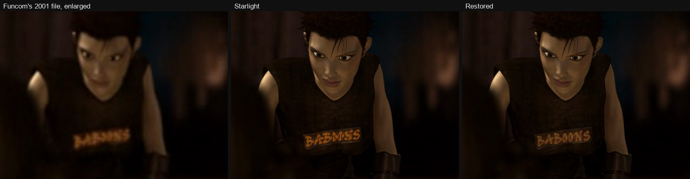
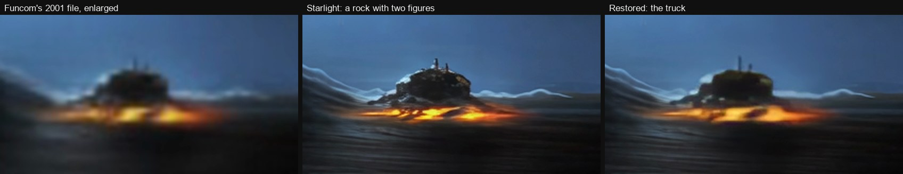
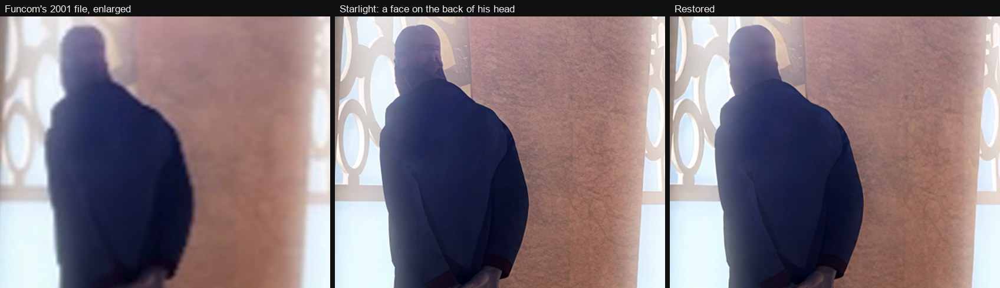
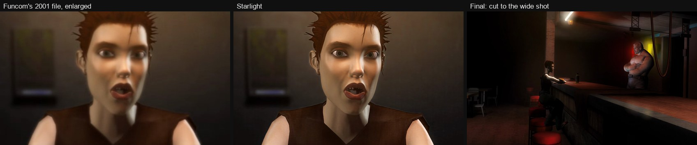

# Anarchy Online: The Animated Series, restored

Funcom made *Anarchy Online: The Animated Series* in 2001, alongside the game's live story: four episodes, released
online in 17 short parts from 31 October to 18 December 2001. The only copies left are Funcom's own release files, at
352×240. The best of them, Funcom's MPEG files, survive thanks to [Timba's Anarchy Online collection](https://drive.google.com/drive/folders/0BxuVjelTHvdWRFQ1eE1WQmNkYXc?resourcekey=0-_ioV-8mB3r1TwCgzzbNinw) on Google
Drive, which saved the contents of Funcom's FTP server in 2016.

This is a restoration of all four episodes in 4K, made with an AI video model and then fixed by hand. The AI video
tools cost about $170 (Topaz's software, $69, and a month of its cloud credits, $99.99). The hand work took about 45
hours of one person's time, over five days in October 2026 ([how that was counted](EFFORT.md#the-human-work)). This
repository documents how it was done: the settings, the scripts, every fix, every decision, and how much of the result
is the AI's work and how much is a person's.

**Watch it on YouTube:** *link to come*

Episode 104. Left: Funcom's 2001 file, enlarged. Middle: the AI upscale, which misspells the shirt. Right: the
restoration, with the right word tracked onto the shirt.

## How it was done

The episodes were enlarged four times with **Starlight**, a generative AI video model made by Topaz Labs. It doesn't
just sharpen. It redraws every frame at the new size, which is why the result looks far better than older upscaling,
and also why it gets things wrong: it misspelled words, turned a distant truck into a rock, drew faces on the backs of
heads.

So every shot was reviewed by eye against the original, and everything that came out wrong was fixed, one by one:
**114 fixes**, each one tried, compared and approved. The exact settings and steps are in [METHOD.md](METHOD.md).

## Corrections, compromises and changes

Most fixes undo the AI's mistakes. A few go further, and change what Funcom made. They are aesthetic calls, and they
are listed separately in [DECISIONS.md](DECISIONS.md) so they can be judged on their own:

- **93 corrections**: the AI drew something the original doesn't show, and the fix puts back what it does.
- **12 compromises**: what the original shows couldn't be recovered at the new size, so the shot plays a little
  differently (a frame held still, a shot swapped, something painted out).
- **9 changes to the original**: the flaw is in Funcom's own animation, and it was changed anyway.

A change to the original: Eleena's teeth are broken in Funcom's close-up too. The restoration cuts away to the
bar's wide shot before they show.

## Who did what

The AI drew the picture: about **99% of the pixels** in the final video are exactly Starlight's. The fixes changed
the other 1%, in 19% of the frames. A person watched every shot, decided what was wrong and what right looks like,
and chose every fix, over about 45 hours of working sessions. An AI coding assistant (Claude, by Anthropic) wrote the
scripts and ran the renders at that person's direction. The numbers, and how they were measured, are in
[EFFORT.md](EFFORT.md).

## What's here

| | |
|---|---|
| [METHOD.md](METHOD.md) | What Starlight is, the source files, the exact settings, and every step from the 2001 files to the YouTube video |
| [DECISIONS.md](DECISIONS.md) | Every fix and why, with its time in the video; the changes to the original first |
| [EFFORT.md](EFFORT.md) | How much is the AI's and how much is human work |
| [SOURCES.md](SOURCES.md) | When each episode came out, forum threads and press from 2001–2002, Funcom's pages, where the files came from |
| [fixes/](fixes/) | The fix tables: every fix, with its frames, its kind and what it draws from |
| [tools/](tools/) | The scripts (Node.js and Python) that made and applied the fixes and built the masters, with the commands in [tools/README.md](tools/README.md) |
| [log/](log/) | The working log of the whole restoration, the review notes, and checksums of Funcom's files |
| [stills/](stills/) | The before-and-after comparisons |

No video is included: not Funcom's files, not the upscale, not the fixes' renders. The restored series is on YouTube,
and [SOURCES.md](SOURCES.md) says where Funcom's original files can be found.

## Thanks

- **Timba**, for the [Anarchy Online collection](https://drive.google.com/drive/folders/0BxuVjelTHvdWRFQ1eE1WQmNkYXc?resourcekey=0-_ioV-8mB3r1TwCgzzbNinw) on Google Drive
  ([its thread on Funcom's forum](https://forums.funcom.com/t/anarchy-online-concept-art-collection-looking-for-more-missing-items/6653)): concept art, game discs, and the contents of Funcom's FTP server, where the
  best surviving copies of the episodes are. Thanks too to **Yumehime**, who gave the collection the FTP's contents.
- The Internet Archive's [Wayback Machine](https://web.archive.org/), which saved Funcom's episode pages and forums
  from 2001–2002.

## About

A fan restoration, made for preservation, alongside the [Anarchaeology](https://anarchaeology.github.io/) screenshot
gallery and [forum archive](https://anarchaeology.github.io/forums/).

Not affiliated with or endorsed by Funcom or Topaz Labs. Anarchy Online and its animated series are © Funcom.
